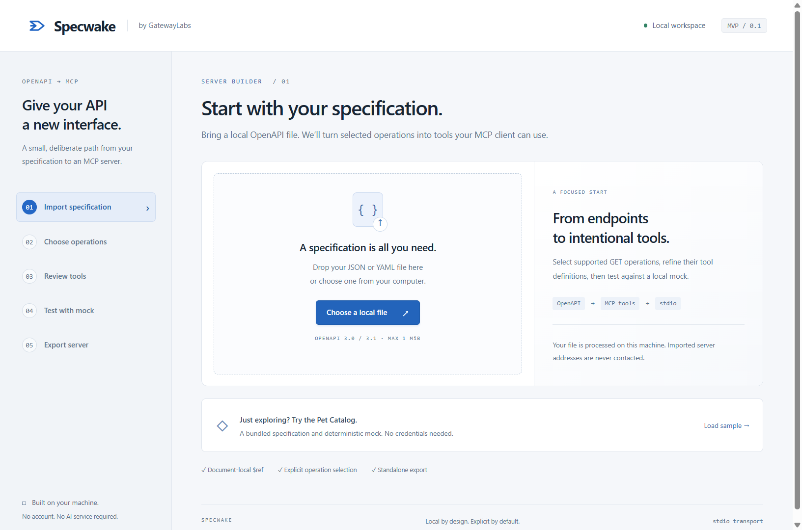

# Specwake Windows desktop

The Electron shell opens the existing five-step authoring UI in a native window. The official Electron security guidance informed the explicit sandbox, context isolation, permission denial and navigation restrictions: https://www.electronjs.org/docs/latest/tutorial/security.

## Build and run

Node.js 24+ and npm are required on the **build machine**, with registry/network access to download the pinned Electron 44.8.0 and electron-builder 26.15.3 toolchain. The **end user** does not need Node.js or npm for Specwake itself.

```sh
npm ci
npm run desktop
```

For distributable files:

```sh
npm run desktop:pack
```

Both Windows x64 outputs are created under `release/`:

- `Specwake-0.1.0-Portable-x64.exe`: self-extracting portable application.
- `Specwake-0.1.0-Setup-x64.exe`: per-user NSIS installer, no admin elevation requested, selectable destination and shortcuts.

The icon is original Specwake geometry, generated reproducibly by `scripts/create-icon.mjs`; no Specfold asset was copied. Code signing is disabled, while application icon and version metadata are applied. These are unsigned MVP builds. An unknown publisher or SmartScreen prompt is possible. No certificate or access credential was created. The [v0.1.0 GitHub Release](https://github.com/Gatewaylabsnet/Specwake/releases/tag/v0.1.0) distributes the portable EXE, setup EXE and SHA-256 checksums separately from the source repository.

`electron-builder.json` packs the UI, compiled backend, selected runtime sources needed for export, templates, fixtures and production dependencies. It excludes development dependencies and source checkout state. ASAR holds application resources; the subprocess runtime and production dependencies are explicitly unpacked so the included Electron executable can run the MCP stdio child without relying on the source checkout or a separate Node installation. Packaging uses `--publish never`.

## Runtime behavior

- The main process starts the studio on port 0, bound only to 127.0.0.1, then loads the actual assigned origin in BrowserWindow. It does not reuse or trust an existing web server.
- Exact Host/Origin/session-token checks are preserved. Renderer requests and navigation are restricted to that origin; blob downloads created by that origin are allowed.
- `nodeIntegration: false`, `contextIsolation: true`, `sandbox: true`, `webSecurity: true`; no preload bridge, webviews, popups or permission grants.
- The MCP test uses the bundled executable with `ELECTRON_RUN_AS_NODE=1`. Runtime files and libraries resolve inside the bundle; probe data is written under the operating system's temporary directory and cleaned after each probe. Installation files are read-only resources.
- A single-instance lock focuses the existing window when launched again. Closing the window shuts down the studio and mock. No background agent or auto-start entry is installed.
- The app has no external links, updater, telemetry or remote code. The exported MCP runtime retains its explicit target and network limits.
- Desktop packaging does not turn the exported MCP ZIP into an EXE. That independent Node.js package remains documented separately in the root README.

## Verification

```sh
npm test
npm run test:export
npm run test:desktop
```

`test:desktop` launches **the packaged** `release/win-unpacked/Specwake.exe --self-test <absolute-report-path>` from `artifacts/`, with PATH restricted to Windows System32 and `ELECTRON_RUN_AS_NODE` removed from the parent. It loads the real UI in a hidden, sandboxed BrowserWindow, checks resource-local dependency resolution, imports the fixture through the packaged HTTP backend, previews the tool, performs a real MCP initialize/list/call with the bundled child executable, verifies Miso's deterministic response, creates a ZIP from bundled resources and rejects a foreign origin.

The self-test writes ignored `artifacts/desktop-verification.json` plus a capture of the actual loaded renderer to `artifacts/desktop-verification.png`. The same command can verify the portable wrapper:

```powershell
powershell -NoProfile -ExecutionPolicy Bypass -File scripts/verify-desktop.ps1 -Executable release\Specwake-0.1.0-Portable-x64.exe
```

There is no remote debugging endpoint or privileged renderer test bridge. The self-test is a fixed backend scenario enabled only by explicit local command-line arguments, not renderer input. An installer is built without installing it on the development machine. Installation/uninstall and SmartScreen acceptance are not automated.

The second working-tree round adds `npm run desktop:pack:dir` for an unpacked build, an isolated self-test user-data profile, process-exit/port-cleanup checks, and `artifacts/desktop-verification-server.zip`. Verify that exact desktop-produced archive with `npm run test:export -- artifacts/desktop-verification-server.zip`; extraction and installation take place outside the source checkout. The Windows/Node 24 CI definition runs these steps but has not been dispatched remotely. See [second-round evidence](ROUND2_VERIFICATION.md). Installer install/uninstall is an explicit separate isolated-Windows gate; it must not be run on the X570 development workstation.

## Recorded result — 16 October 2026

The ASAR-packaged `win-unpacked/Specwake.exe` passed the packaged verification with bundled Electron 44.8.0 / Node.js 24.22.0. The operating-system PATH contained only System32 during this check. The package's own dependencies, UI, fixture, subprocess, and export templates were used successfully; no global Node.js or source working directory was needed.

The final single-file portable wrapper passed the same check after extraction. Both generated EXEs carry Specwake 0.1.0 product metadata and were confirmed `NotSigned` with `Get-AuthenticodeSignature`. `release/SHA256SUMS.txt` records the local binary hashes. The final source suite passed **19/19**, and independent ZIP installation/build/MCP verification and the production dependency audit also passed (0 reported runtime dependency vulnerabilities).

The source suite additionally exercises the desktop navigation policy and the ephemeral port's real HTTP Host rejection. The previous web-mode and standalone-export tests remain part of the same suite. The installer is generated for distribution but is not installed on this workstation by the verification script.


