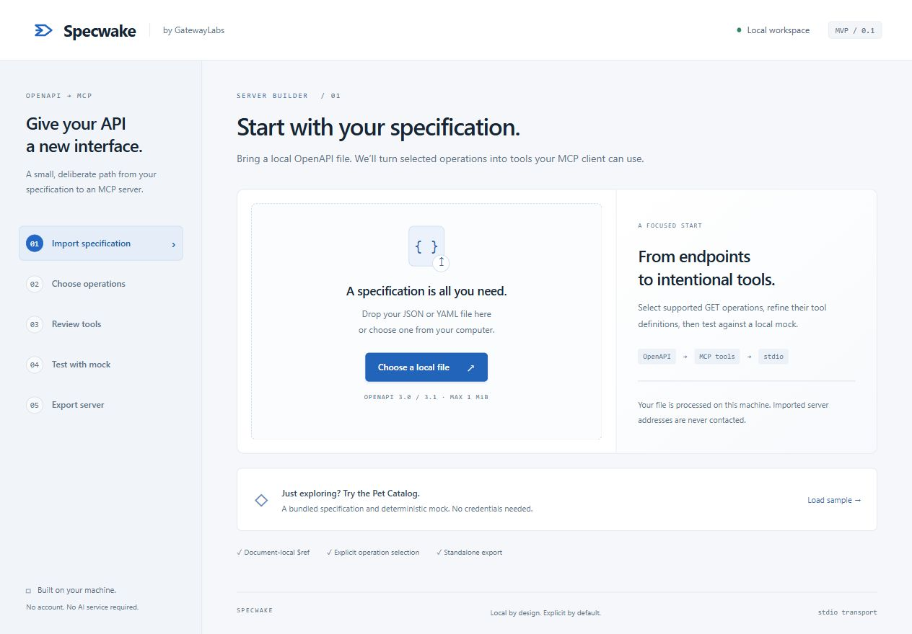
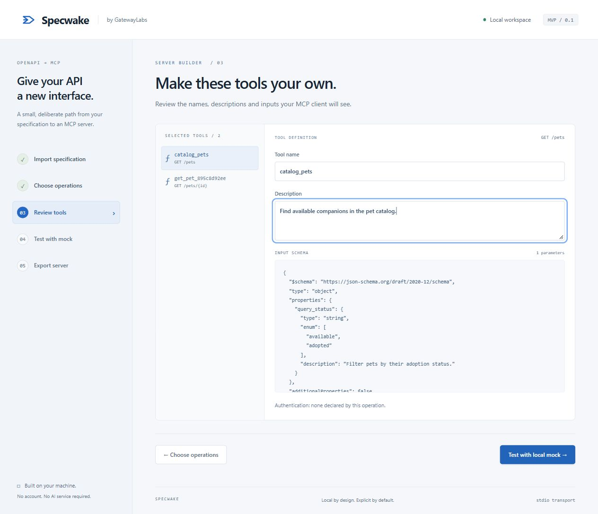
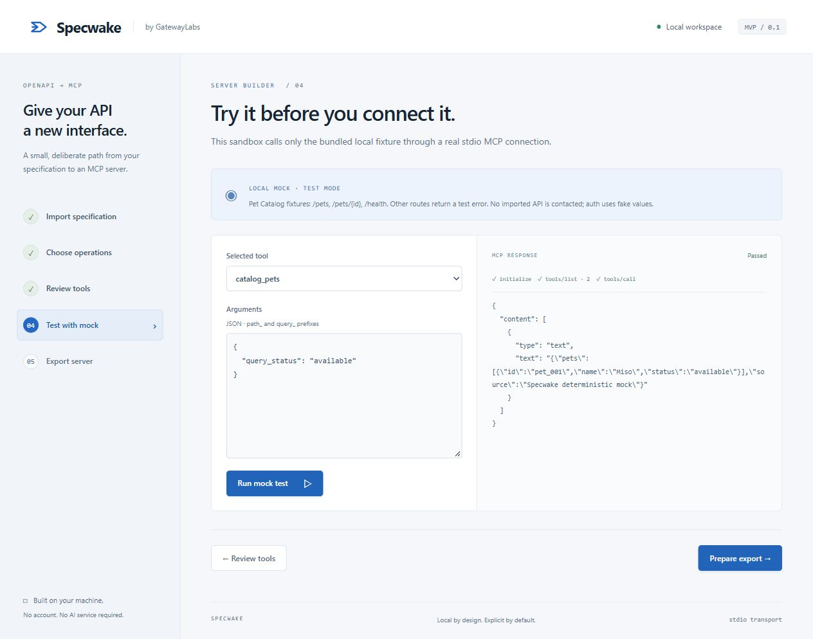
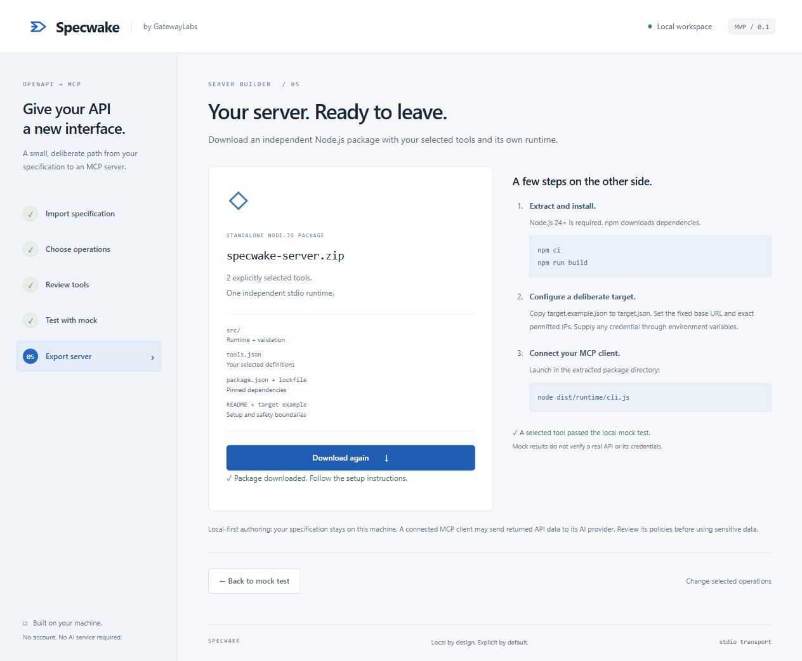
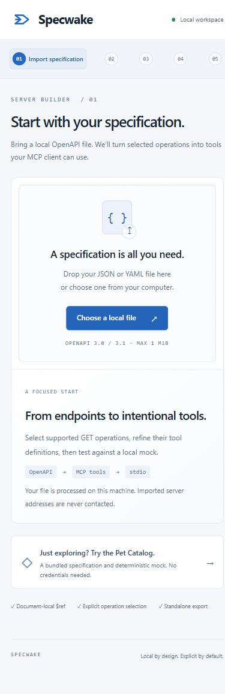

# Specwake MVP — doğrulama kaydı

Tarih: 16 Ekim 2026 (Europe/Istanbul). Çalışma klasörü: `C:\Projects\Specwake`. Depo: `https://github.com/Gatewaylabsnet/Specwake`. Dal: `codex/specwake-mvp`.

Başlangıçta yerel klasör boştu. Doğru GitHub deposu mevcut klasöre alındı; başlangıç HEAD'i `9cac96fede488f7095cda5697884a6a181acbb59` yalnızca LICENSE içeriyordu. README/AGENTS.md veya korunması gereken yerel değişiklik yoktu. ConfigDiffTool ve Specfold dosyaları değiştirilmedi. İlk MVP tesliminde push yapılmadı; sonraki Windows EXE ve GitHub commit/push isteği ayrı olarak uygulandı. PR, GitHub Release, deploy veya kalıcı credential oluşturulmadı.

## Gerçek sonuçlar

| Kontrol | Sonuç |
| --- | --- |
| `npm run build` | Başarılı: strict TypeScript, Vite üretim derlemesi ve runtime derlemesi |
| `npm test` | 17/17 geçti; atlanan/iptal edilen test yok |
| `npm run test:export` | ZIP temiz klasöre çıkarıldı; npm ci, bağımsız build, MCP initialize/list/call ve seçilmeyen araç reddi geçti |
| `npm run test:export -- artifacts/ui-export.zip` | Gerçek arayüz indirmesi ayrıca doğrulandı; catalog_pets ve get_pet_895c8d92ee listelendi; Miso mock yanıtı alındı |
| `npm audit --omit=dev --audit-level=high` | 0 güvenlik açığı |
| Ağ dinleme kontrolü | Yönetim sunucusu yalnızca 127.0.0.1:4318 üzerinde |
| Tarayıcı konsolu | Ana beş adımlı akışta error/warn yok |

Testler geçerli JSON/YAML, bozuk/desteklenmeyen belgeler, harici/kırık/döngülü referanslar, boyut/derinlik/yapı sınırları, kararlı isimler, düzenleme/çakışmalar, desteklenmeyen işlemler, path kaçışları, tür/zorunlu alan/enum, hedef izinleri, yönlendirme, 5 saniye zaman aşımı, 256 KiB yanıt sınırı, eksik auth, secret maskeleme, export/log sızıntısı ve Origin/Host/CSRF korumasını kapsar.

## Tarayıcıda gözlenen akış

1. Başlangıç ekranı açıldı. Örnek YAML belgesi yüklendi; hiçbir işlem başlangıçta seçili değildi.
2. GET /pets ve GET /pets/{id} seçildi. POST ve deepObject filtreli GET engelleri görünür kaldı.
3. İlk aracın adı `catalog_pets`, açıklaması `Find available companions in the pet catalog.` olarak değiştirildi. JSON giriş şeması ve bağlı işlem görüntülendi.
4. `query_status: available` ile gerçek stdio MCP bağlantısı kuruldu. initialize, iki araçla tools/list ve tools/call başarılı oldu; Miso döndü.
5. `query_status: invalid` araç seviyesinde reddedildi. Değer düzeltilip aynı ekrandan yeniden çağrıldığında başarılı oldu.
6. ZIP indirme düğmesi çalıştı ve başarı durumu görüntülendi. İndirilen ZIP `artifacts/ui-export.zip` içine taşındı ve temiz kurulum doğrulamasından geçirildi.
7. Geri dönüşle dosya seçici açılıp yerel `examples/health.json` dosyası içe aktarıldı; Service Health / OpenAPI 3.0.3 görüntülendi.
8. `examples/pet-catalog.yaml` gerçek dosya seçiciden de içe aktarıldı. Boş arama sonucu ve filtre temizleme kontrol edildi. İşlemler Space ile seçildi, adımlar Enter ile geçildi.
9. 390 piksel viewport ile dar ekran incelendi; içerik genişliği kullanılabilir alanı aşmadı. Varsayılan ekran boyutu test sonrası geri yüklendi.

## Kapsam ve doğrulama sınırları

OpenAPI 3.0.x/3.1.x, GET, belge içi ref, scalar path/query ve enum desteği vardır. Karmaşık şemalar/serialization, OAuth, IPv6 ve dual-stack hedefler desteklenmez. Güvenlik sınırları ve ayrıntılı destek matrisi ana README'dedir.

Gerçek API, gerçek credential, kurumsal ağ veya harici HTTP MCP transportu denenmedi. Sonraki istekte Windows desktop ve kurulum paketleri eklendi; masaüstü kanıtı [DESKTOP.md](DESKTOP.md) içindedir. Mock yalnızca projeye ait sabit fixture'ları doğrular. Kaynak ve ZIP değiştirilebilir yerel dosyalardır; paket imzası veya kötü niyetli yerel işleticiye karşı sandbox sağlamaz. İlk npm kurulumu internet gerektirir; uygulama akışı ücretli AI servisi gerektirmez.

Üretilen kod: core import/contract, stdio runtime, hedef politikası/HTTP istemcisi, mock, loopback studio API, ZIP exporter, React arayüzü, JSON/YAML örnekleri, iki lockfile ve otomatik doğrulama scriptleri. Tam dosya listesi `git status --short` ile görülebilir.

## v0.1.0 yayımlama — 17 Ekim 2026

Kullanıcının ayrıca verdiği release yayımlama isteğiyle portable ve kurulum EXE'leri, SHA256SUMS.txt ile birlikte v0.1.0 GitHub Release'e eklendi. İmzalanmamış ikili dosyaların hash değerleri, 16 Ekim'deki paketleme ve portable doğrulamasında kullanılan dosyalarla aynı olduğu kontrol edilerek doğrulandı. Yayımlama hazırlığı yalnızca indirme bağlantıları ve bu kaydı değiştirdi; uygulama kodu ve ikili dosyalar yeniden değiştirilmedi.
